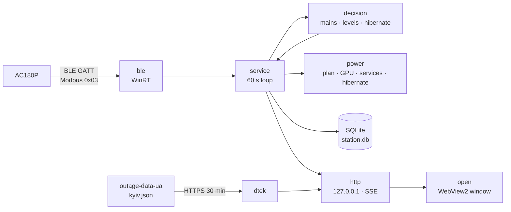

<div align="center">


# Bluetti Watcher

**Watches a BLUETTI AC180P power station in the background and protects your PC during power cuts: eco mode first, hibernation before the battery runs out.**

A single Rust exe that reads the station over Bluetooth LE once a minute — no window, no tray icon; charts open from a shortcut.

**English** · [Українська](README.uk.md) · [Русский](README.ru.md)


</div>

---

<p align="center"></p>

<p align="center"></p>

## Features

| | |
|---|---|
| 🔋 **Reads the station over Bluetooth** | Once a minute: charge, AC/DC input and output, grid voltage. Read-only — the program never changes a station setting. |
| 🌙 **Invisible in the background** | No window, console or tray icon; starts at Windows sign-in without admin rights. Idles at ~0 % CPU and a few megabytes of RAM. |
| 📈 **Dashboard from a shortcut** | Its own frameless dark window: charge, time left, power, charts for 6 h / 24 h / 7 d / 30 d, outages and events. |
| ⚡ **Eco during a power cut** | After 3 minutes without mains: the «Bluetti Eco» power plan (CPU up to 80 %, display off after 3 min, best power efficiency), an NVIDIA power limit, Windhawk and NVIDIA Instant Replay stopped. Deep eco at 20 %. |
| 🛌 **Hibernation before empty** | A notification at 7 %, hibernation at 5 % — only after a fresh reading confirms it. With a fast drain the thresholds move up in advance. |
| 🗓 **DTEK outage schedule** | Planned outages for today and tomorrow (Kyiv), as an hour grid like the DTEK app. The queue is picked from real outages the station sees. Display only. |

## How it reacts

| When | What happens |
|---|---|
| No mains for 3 minutes | The outage starts, eco turns on |
| Charge 20 % | Deep eco: CPU up to 50 %, GPU at its minimum limit, a notification |
| Charge 10 % | Notification «save your work» |
| Charge 7 % | Notification: the PC will hibernate in about N minutes |
| Charge 5 % | Hibernation, if a fresh reading confirms it |
| Mains back for 3 minutes | The previous power plan, GPU limit and services come back |

A level fires only after two agreeing readings. A charge jump (a glitch or the station recalibrating) is rejected, and if
the low charge holds, hibernation waits for 10 minutes of confirmation. All thresholds are configurable.

**PC mode buttons** (the UI is in Russian): «Авто» (Auto) — eco only during an outage; «Eco» — eco now, even on mains;
«Максимум» (Max) — no saving until the next mains change or «Авто». Low-charge notifications and hibernation work in every mode; only the empty file `no-hibernate`
turns hibernation off.

**Time left** uses the average load, not the momentary one: the all-time average for «if power goes out», the average
since the outage began during a cut (or the measured discharge rate once there is enough data).

## Installation

The latest build is on the **[Releases](https://github.com/Reva1v/bluetti-watcher/releases)** page; you can also build
from source (below). Then, in PowerShell from the folder with the exe:

```powershell
.\bluetti-watcher.exe scan | Out-Host                             # find the station: name, address, signal
.\bluetti-watcher.exe install --elevated-setup | Out-Host         # install (the station is found by itself)
.\bluetti-watcher.exe install --mac AA:BB:CC:DD:EE:FF | Out-Host  # or give the address explicitly
```

`| Out-Host` is needed because the exe has no console: this way PowerShell waits for the command's output.

`install`:
- copies the exe to `%LOCALAPPDATA%\bluetti-watcher\bin\` and writes `config.toml` with the station address;
- creates the «Bluetti Eco» power plan (your own plans are not changed);
- registers the `BluettiWatcher` scheduled task: starts at sign-in, no admin rights, restarts on failure;
- creates «Bluetti Watcher» shortcuts on the Desktop and in the Start menu;
- starts the service.

`--elevated-setup` asks for UAC once: turns Windows hibernation on (`powercfg /h on`) and creates the
`BluettiWatcherGpu` task that sets the GPU limit and stops/starts Windhawk and the NVIDIA container. Without it eco works
without those parts, and the dashboard warns you if hibernation is off.

The exe is not code-signed, so Windows may warn on first start. Check the SHA-256 of the release zip against its
`.sha256` file.

## Usage

- **Dashboard** — the «Bluetti Watcher» shortcut. Closing the window does not stop the service; if the service is not
  running, the shortcut starts it.
- **One-line status** — `bluetti-watcher status | Out-Host`.
- **Link check** — `bluetti-watcher read-once --trace | Out-Host` prints the fields and the protocol frames.
- **Hibernation kill switch** — an empty file `%LOCALAPPDATA%\bluetti-watcher\no-hibernate`; checked on every cycle.
- **Dry run** — `dry_run = true` in `config.toml` (or `run --dry-run`): every action on the PC only goes to the log.
- **Uninstall** — `bluetti-watcher uninstall | Out-Host` restores the power plan and removes the tasks, shortcuts and the
  «Bluetti Eco» plan; data stays. `--purge` removes it too.

## Configuration

`%LOCALAPPDATA%\bluetti-watcher\config.toml`. Only `mac` is required; everything else has defaults:

```toml
mac = "AA:BB:CC:DD:EE:FF"
port = 8765                 # dashboard on 127.0.0.1
poll_sec = 60
dry_run = false

[station]
capacity_wh = 1440          # AC180P
efficiency = 0.85

[mains]
lost_sec = 180              # how long without mains before eco
back_sec = 180

[levels]
low = 20                    # deep eco
critical = 10
warn = 7
hibernate = 5

[eco]
power_scheme = true
cpu_max_pct = 80
deep_cpu_max_pct = 50
efficiency_overlay = true
monitor_off_sec = 180
gpu = true
gpu_pct = 70                # of the default limit, never below the card's minimum
deep_gpu_pct = 0            # 0 = the card's minimum
stop_replay = true          # stop Windhawk, then the NVIDIA container (Instant Replay)

[dtek]
enabled = false
region = "kyiv"             # dataset kyiv.json
address = ""                # caption on the card only
queues = []                 # candidate queues, e.g. ["GPV9.1", "GPV21.1"]
min_cut_min = 15            # shorter cuts do not count when picking the queue
warn_min = 60               # Windows notification this many minutes before a planned cut (0 = off)
```

Every key and its limits: [contracts/cli-config.md](specs/001-rust-station-watcher/contracts/cli-config.md); the
schedule: [specs/002-dtek-schedule](specs/002-dtek-schedule/spec.md).

## Safety and privacy

- Only Modbus read commands (0x03) and secure-connection handshake steps go to the station; a test checks every outgoing
  frame.
- HTTP listens on `127.0.0.1` only and rejects a foreign `Host`; changing the mode needs a header other sites cannot send.
- The only outbound request is an HTTPS GET of the public dataset
  [Baskerville42/outage-data-ua](https://github.com/Baskerville42/outage-data-ua) every 30 minutes, and only with
  `[dtek] enabled = true`. Your address never leaves the PC; there is no BLUETTI cloud.

## Building from source

Windows 10/11 x64 with Bluetooth LE and [Rust](https://rustup.rs/) stable (1.97+).

```powershell
cargo build --release      # target\release\bluetti-watcher.exe
cargo test                 # protocol, decisions, storage, API, schedule
```

## Architecture

A single-threaded service (tokio current_thread): a reading loop once a minute, decisions as a pure function without
I/O, actions on the PC through traits that tests replace with fakes. The schedule refreshes in its own task.



| Layer | Technologies |
|---|---|
| Bluetooth and Windows API | `windows` (WinRT GATT and HTTP, powrprof, Task Scheduler, services, Shell, DWM) |
| Protocol | Modbus RTU, BLUETTI IoT v2 encryption on RustCrypto (`p256`, `aes`, `cbc`, `md-5`) |
| Storage | `rusqlite` (SQLite, bundled) |
| API and dashboard | `axum`, SSE, framework-free HTML/CSS/JS, uPlot charts |
| Window | `wry` + `tao` (WebView2) |
| GPU and notifications | `nvml-wrapper`, `tauri-winrt-notification` |

## Project layout

```
src/ble/           station reading: WinRT transport, Modbus, encryption, AC180P registers, scan
src/decision/      decisions: reading checks, mains and outages, levels and hibernation
src/power/         eco: «Bluetti Eco» plan, overlay, GPU limit, services, hibernation
src/dtek/          DTEK schedule: dataset fetch, parsing, outage windows, queue selection
src/http/          API, SSE and the embedded dashboard (web/)
src/service.rs     service loop
src/install.rs     install / uninstall / status
src/window.rs      dashboard window
tests/             protocol against a fake station, decision scenarios, dataset fixture
specs/             specifications, plans, tasks (Spec Kit; in Russian)
design/            dashboard mockups
docs/images/       README screenshots
```

## Development

```powershell
cargo fmt --check
cargo clippy --all-targets -- -D warnings
cargo test                                   # 167 tests
cargo test --lib -- --ignored real_fetch     # one real request to the DTEK dataset
```

Features follow Spec Kit: [`specs/`](specs/) holds the specifications, plans, protocol research, API contracts and
validation scenarios (in Russian).

## Origin and license

Rewritten in Rust from [vitaliy-shatskiy/bluetti-watcher](https://github.com/vitaliy-shatskiy/bluetti-watcher)
(C# + Python): the decision rules come from there; the cloud source and the flag file were dropped, the DTEK module was
redone on the public dataset. The station protocol is ported from
[bluetti-bt-lib](https://pypi.org/project/bluetti-bt-lib/). License — [MIT](LICENSE).

An independent project, not affiliated with BLUETTI or DTEK.
