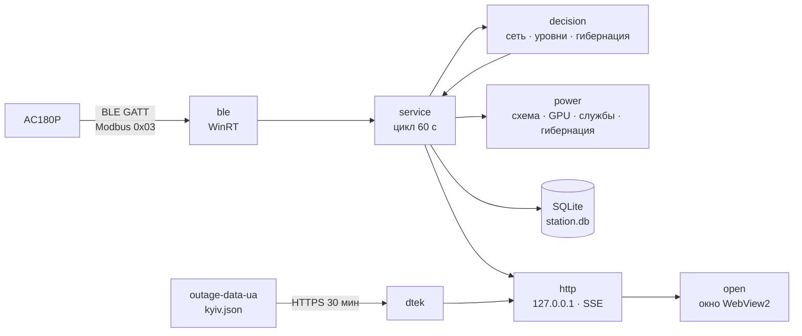

<div align="center">


# Bluetti Watcher

**Следит за станцией BLUETTI AC180P в фоне и защищает ПК при отключении света: сначала eco-режим, а перед разрядом — гибернация.**

Один exe на Rust: раз в минуту читает станцию по Bluetooth LE, без окна и значка в трее; графики — по ярлыку.

[English](README.md) · [Українська](README.uk.md) · **Русский**


</div>

---

<p align="center"></p>

<p align="center"></p>

## Возможности

| | |
|---|---|
| 🔋 **Чтение станции по Bluetooth** | Раз в минуту: заряд, вход и выход AC/DC, напряжение сети. Только чтение — настройки станции программа не меняет никогда. |
| 🌙 **Невидимо в фоне** | Без окна, консоли и трея; запускается при входе в Windows без прав администратора. В простое — около 0 % CPU и единицы мегабайт памяти. |
| 📈 **Дашборд по ярлыку** | Своё тёмное окно без системной рамки: заряд, сколько осталось, мощности, графики за 6 ч / 24 ч / 7 д / 30 д, отключения и события. |
| ⚡ **Eco при отключении света** | Через 3 минуты без сети: схема питания «Bluetti Eco» (CPU до 80 %, монитор гаснет через 3 мин, наилучшая энергоэффективность), лимит мощности NVIDIA, остановка Windhawk и NVIDIA Instant Replay. На 20 % — глубокий eco. |
| 🛌 **Гибернация до разряда** | Уведомление на 7 %, гибернация на 5 % — только после свежего подтверждающего показания. При быстром разряде пороги поднимаются заранее. |
| 🗓 **График отключений ДТЭК** | Плановые отключения на сегодня и завтра (Киев), сеткой часов, как в приложении ДТЭК. Очередь определяется по реальным отключениям, которые видит станция. Только показ. |

## Как это реагирует

| Когда | Что происходит |
|---|---|
| Сети нет 3 минуты | Начинается отключение, включается eco |
| Заряд 20 % | Глубокий eco: CPU до 50 %, GPU на минимальном лимите, уведомление |
| Заряд 10 % | Уведомление «сохраните работу» |
| Заряд 7 % | Уведомление: ПК уйдёт в гибернацию примерно через N минут |
| Заряд 5 % | Гибернация, если свежее показание это подтверждает |
| Сеть вернулась на 3 минуты | Возвращаются прежняя схема питания, лимит GPU и службы |

Уровень срабатывает только после двух согласных показаний. Скачок заряда (сбой или перекалибровка станции) отвергается,
а если низкий заряд держится — гибернация ждёт 10 минут подтверждения. Все пороги настраиваются.

**Кнопки режима ПК:** «Авто» — eco только во время отключения; «Eco» — eco сейчас, даже при сети; «Максимум» — без
экономии до следующего изменения сети или «Авто». Уведомления о низком заряде и гибернация работают в любом режиме;
гибернацию отключает только пустой файл `no-hibernate`.

**Оставшееся время** считается по средней нагрузке, а не мгновенной: для «если свет пропадёт» — по средней за всю
историю, во время отключения — по средней с его начала (или по измеренной скорости разряда, когда данных достаточно).

## Установка

Свежая сборка — на странице **[Releases](https://github.com/Reva1v/bluetti-watcher/releases)**; можно и собрать из
исходников (ниже). Затем в PowerShell из папки с exe:

```powershell
.\bluetti-watcher.exe scan | Out-Host                             # найти станцию: имя, адрес, сигнал
.\bluetti-watcher.exe install --elevated-setup | Out-Host         # установить (станция найдётся сама)
.\bluetti-watcher.exe install --mac AA:BB:CC:DD:EE:FF | Out-Host  # или указать адрес явно
```

`| Out-Host` нужен потому, что exe собран без консоли: так PowerShell дождётся вывода команды.

`install`:
- копирует exe в `%LOCALAPPDATA%\bluetti-watcher\bin\` и пишет `config.toml` с адресом станции;
- создаёт схему питания «Bluetti Eco» (ваши схемы не меняются);
- регистрирует задачу планировщика `BluettiWatcher` — запуск при входе, без прав администратора, перезапуск при сбое;
- создаёт ярлыки «Bluetti Watcher» на Рабочем столе и в меню «Пуск»;
- запускает сервис.

`--elevated-setup` один раз запрашивает UAC: включает гибернацию Windows (`powercfg /h on`) и создаёт задачу
`BluettiWatcherGpu`, которая ставит лимит GPU и останавливает/запускает Windhawk и контейнер NVIDIA. Без него eco
работает без этих частей, а дашборд предупредит, если гибернация выключена.

Exe не подписан, поэтому Windows может предупредить при первом запуске. Сверьте SHA-256 архива с файлом `.sha256`.

## Использование

- **Дашборд** — ярлык «Bluetti Watcher». Закрытие окна сервис не останавливает. Если сервис не запущен, ярлык запустит его.
- **Состояние одной строкой** — `bluetti-watcher status | Out-Host`.
- **Проверка связи** — `bluetti-watcher read-once --trace | Out-Host` печатает поля и кадры протокола.
- **Выключатель гибернации** — пустой файл `%LOCALAPPDATA%\bluetti-watcher\no-hibernate`; проверяется на каждом цикле.
- **Пробный режим** — `dry_run = true` в `config.toml` (или `run --dry-run`): все действия над ПК только пишутся в лог.
- **Удаление** — `bluetti-watcher uninstall | Out-Host` возвращает схему питания и убирает задачи, ярлыки и схему
  «Bluetti Eco»; данные остаются. `--purge` удаляет и их.

## Настройка

`%LOCALAPPDATA%\bluetti-watcher\config.toml`. Обязателен только `mac`; остальное — значения по умолчанию:

```toml
mac = "AA:BB:CC:DD:EE:FF"
port = 8765                 # дашборд на 127.0.0.1
poll_sec = 60
dry_run = false

[station]
capacity_wh = 1440          # AC180P
efficiency = 0.85

[mains]
lost_sec = 180              # сколько ждать без сети до eco
back_sec = 180

[levels]
low = 20                    # глубокий eco
critical = 10
warn = 7
hibernate = 5

[eco]
power_scheme = true
cpu_max_pct = 80
deep_cpu_max_pct = 50
efficiency_overlay = true
monitor_off_sec = 180
gpu = true
gpu_pct = 70                # от номинала, не ниже минимального лимита карты
deep_gpu_pct = 0            # 0 = минимальный лимит
stop_replay = true          # остановить Windhawk, затем контейнер NVIDIA (Instant Replay)

[dtek]
enabled = false
region = "kyiv"             # набор данных kyiv.json
address = ""                # только подпись на карточке
queues = []                 # очереди-кандидаты, например ["GPV9.1", "GPV21.1"]
min_cut_min = 15            # более короткие отключения не учитываются при выборе очереди
warn_min = 60               # уведомление Windows за столько минут до планового отключения (0 — выкл.)
```

Полный список ключей и пределы — [contracts/cli-config.md](specs/001-rust-station-watcher/contracts/cli-config.md);
график — [specs/002-dtek-schedule](specs/002-dtek-schedule/spec.md).

## Безопасность и приватность

- К станции уходят только команды чтения Modbus (0x03) и шаги защищённого соединения; тест проверяет каждый исходящий кадр.
- HTTP слушает только `127.0.0.1` и отклоняет запросы с чужим `Host`; смена режима требует заголовка, который другие
  сайты отправить не могут.
- Единственный внешний запрос — HTTPS GET публичного набора данных
  [Baskerville42/outage-data-ua](https://github.com/Baskerville42/outage-data-ua) раз в 30 минут и только при
  `[dtek] enabled = true`. Ваш адрес никуда не уходит; облака BLUETTI нет.

## Сборка из исходников

Windows 10/11 x64 с Bluetooth LE и [Rust](https://rustup.rs/) stable (1.97+).

```powershell
cargo build --release      # target\release\bluetti-watcher.exe
cargo test                 # протокол, решения, хранилище, API, график
```

## Архитектура

Сервис однопоточный (tokio current_thread): цикл чтения раз в минуту, решения — чистая функция без I/O, действия над
ПК — через трейты, которые в тестах подменяются фейками. График обновляется в своей задаче.



| Слой | Технологии |
|---|---|
| Bluetooth и Windows API | `windows` (WinRT GATT и HTTP, powrprof, Task Scheduler, службы, Shell, DWM) |
| Протокол | Modbus RTU, шифрование BLUETTI IoT v2 на RustCrypto (`p256`, `aes`, `cbc`, `md-5`) |
| Хранилище | `rusqlite` (SQLite, bundled) |
| API и дашборд | `axum`, SSE, HTML/CSS/JS без фреймворков, графики uPlot |
| Окно | `wry` + `tao` (WebView2) |
| GPU и уведомления | `nvml-wrapper`, `tauri-winrt-notification` |

## Структура проекта

```
src/ble/           чтение станции: WinRT-транспорт, Modbus, шифрование, регистры AC180P, сканирование
src/decision/      решения: проверки показаний, сеть и отключения, уровни и гибернация
src/power/         eco: схема «Bluetti Eco», оверлей, лимит GPU, службы, гибернация
src/dtek/          график ДТЭК: загрузка набора, разбор, окна отключений, выбор очереди
src/http/          API, SSE и встроенный дашборд (web/)
src/service.rs     цикл сервиса
src/install.rs     install / uninstall / status
src/window.rs      окно дашборда
tests/             протокол против фейковой станции, сценарии решений, фикстура набора
specs/             спецификации, планы, задачи (Spec Kit)
design/            макеты дашборда
docs/images/       скриншоты для README
```

## Разработка

```powershell
cargo fmt --check
cargo clippy --all-targets -- -D warnings
cargo test                                   # 167 тестов
cargo test --lib -- --ignored real_fetch     # один реальный запрос к набору данных ДТЭК
```

Фичи ведутся по Spec Kit: в [`specs/`](specs/) — спецификации, планы, исследование протокола, контракты API и сценарии
проверки.

## Происхождение и лицензия

Переписано на Rust с [vitaliy-shatskiy/bluetti-watcher](https://github.com/vitaliy-shatskiy/bluetti-watcher)
(C# + Python): правила решений перенесены оттуда, облачный источник и флаг-файл убраны, модуль ДТЭК сделан заново на
публичном наборе данных. Протокол станции портирован с [bluetti-bt-lib](https://pypi.org/project/bluetti-bt-lib/).
Лицензия — [MIT](LICENSE).

Проект независимый и не связан с BLUETTI или ДТЭК.
