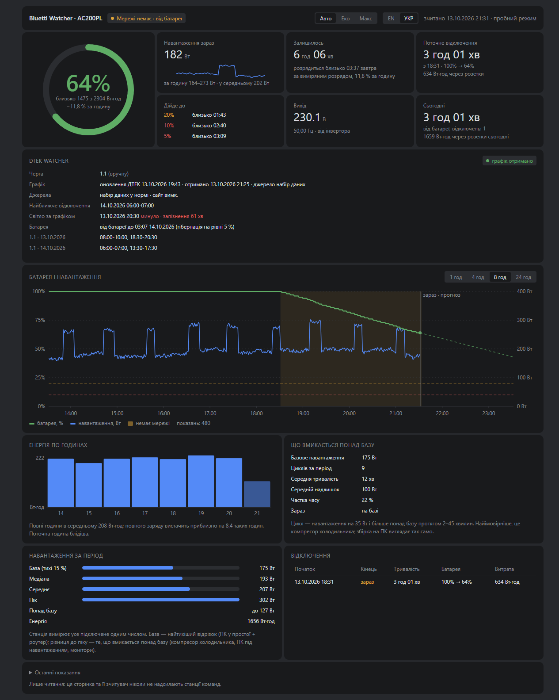
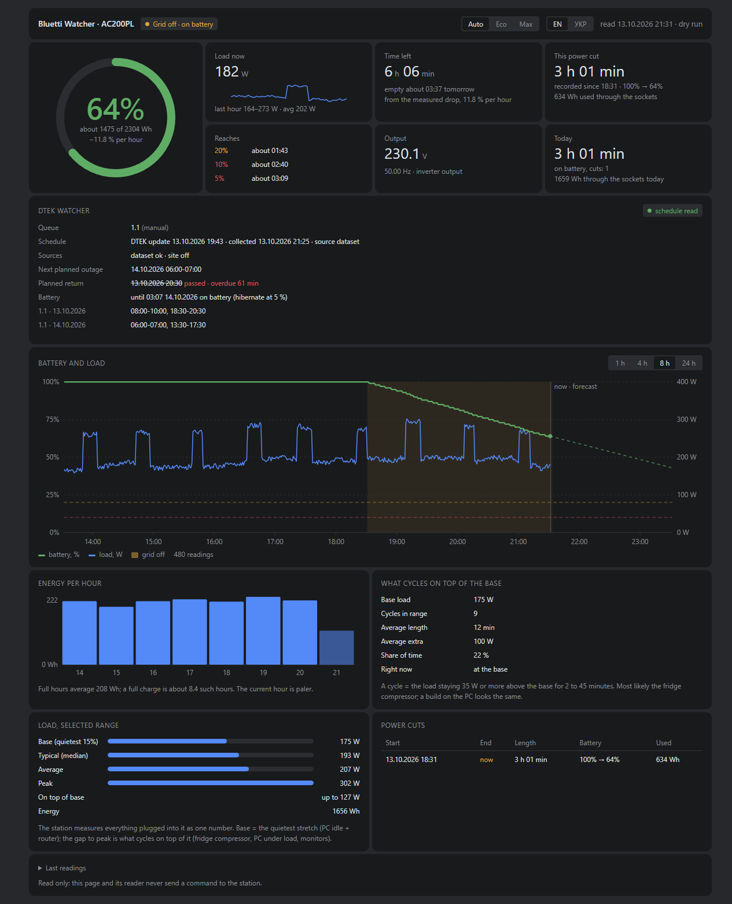

[English](README.md) · **Українська**

# Bluetti Watcher

**Тримає ваш комп'ютер на Windows увімкненим під час відключень світла від зарядної станції BLUETTI - і вчасно
переводить його в режим глибокого сну, поки батарея не сіла.**

[](https://github.com/vitaliy-shatskiy/bluetti-watcher/actions/workflows/ci.yml)
[](https://github.com/vitaliy-shatskiy/bluetti-watcher/releases/latest)

[](LICENSE)

<p align="center">
  
</p>

В Україні планові й аварійні відключення - буденність, а стаціонарний комп'ютер на зарядній станції просто тихо
вимикається, коли батарея сідає. Bluetti Watcher щохвилини зчитує станцію через Bluetooth LE: коли зникає світло, він
перемикає комп'ютер в енергоощадний режим, на низькому заряді вмикає аварійний, а перед тим як станція розрядиться,
переводить комп'ютер у глибокий сон. Коли світло повертається, усе стає як було, а невелика панель на `127.0.0.1`
показує заряд, навантаження, скільки ще вистачить і історію.

## How it reacts

| Коли | Що відбувається |
|---|---|
| Світла немає 3 хвилини | Еко: схема живлення Windows «Енергозбереження», обмеження потужності відеокарти NVIDIA (якщо налаштовано), прапорець каже «eco» |
| Заряд 20 % | Аварійний режим: прапорець каже програмам, що його читають, згортати роботу |
| Заряд 10 % | Стоп: рівень у прапорці - critical, сигнал зберегти роботу й зупинитися |
| Заряд 7 % | Попередження про глибокий сон |
| Заряд 5 % | Комп'ютер іде в глибокий сон, коли свіже зчитування це підтверджує |
| Світло є 3 хвилини | Усі режими знято, повернуто попередню схему живлення |

Усі пороги налаштовуються. Рівень спрацьовує лише після двох узгоджених зчитувань; повні правила - у
[docs/design.md](docs/design.md) (англійською).

## Quick start

Потрібні Windows 10 або 11 x64 з адаптером Bluetooth LE, PowerShell 7 (`pwsh`), Python 3.12, 3.13 або 3.14 у `PATH`
(звичайна збірка, не free-threaded) і Chrome або Edge.

1. Завантажте `bluetti-watcher-<версія>-win-x64.zip` і файл `.sha256` з
   [останнього релізу](https://github.com/vitaliy-shatskiy/bluetti-watcher/releases/latest), звірте хеш і розпакуйте
   архів:

   ```powershell
   (Get-FileHash .\bluetti-watcher-*-win-x64.zip).Hash   # має збігатися з хешем у файлі .sha256
   ```

2. Знайдіть Bluetooth-адресу станції (у застосунку BLUETTI або в Параметрах Windows > Bluetooth).
3. У PowerShell 7, у розпакованій теці:

   ```powershell
   pwsh -NoProfile -File install.ps1 -Mac AA:BB:CC:DD:EE:FF          # пробний запуск: показує кожен крок і що йому заважає
   pwsh -NoProfile -File install.ps1 -Mac AA:BB:CC:DD:EE:FF -Apply   # встановлення
   ```

Усе встановлюється в `%LOCALAPPDATA%\bluetti-watcher` (`bin\`, `power-mode\`, `.venv\`, `config.json`, `station.db`,
`service.log`). Інсталятор реєструє завдання `BluettiWatcher`, що запускається під час входу (від поточного
користувача, без прав адміністратора), запускає його, чекає на відповідь `/api/health`, реєструє завдання пробудження
(вимкнене) і створює ярлик `Bluetti Watcher` на робочому столі та в меню «Пуск».

Необов'язково, один раз, з PowerShell від імені адміністратора: для обмеження потужності відеокарти NVIDIA в еко-режимі
потрібні два заплановані завдання, які може зареєструвати лише адміністратор:

```powershell
pwsh -NoProfile -File "$env:LOCALAPPDATA\bluetti-watcher\power-mode\power-mode.ps1" gpu-task install
```

## Features

- Зчитує станцію через Bluetooth LE лише на читання; за бажання - резервне зчитування з хмари BLUETTI, коли Bluetooth
  мовчить.
- Еко, аварійний режим, стоп, попередження й глибокий сон залежно від світла й заряду; усі пороги налаштовуються.
- Захист від хибних даних: неправдоподібні стрибки відкидаються, після перекалібрування станції - довше підтвердження.
- Панель українською та англійською: заряд, скільки вистачить за поточного навантаження, відключення, історія, події.
- Ручне керування на сторінці: Auto, Eco, Max.
- Власна команда на початок кожного режиму (`actions`) і файл-прапорець, який можуть читати інші програми.
- За бажання - таймер пробудження та графік планових відключень ДТЕК (Київщина).
- Один NativeAOT exe, заплановане завдання для користувача, без вікна й без значка в треї.

## Screenshots

| English | Українська |
|---|---|
|  |  |

Обидва знімки зроблено під час імітації відключення (синтетичні дані).

## Supported hardware

- BLUETTI AC200PL: перевірено.
- Інші моделі BLUETTI, які підтримує [bluetti-bt-lib](https://pypi.org/project/bluetti-bt-lib/), можуть працювати
  (вкажіть `type` у налаштуваннях); не перевірено. Ваш звіт допоможе:
  [підтримка станції](https://github.com/vitaliy-shatskiy/bluetti-watcher/issues/new?template=station_support.yml).

Bluetti Watcher - незалежний проєкт, не пов'язаний з BLUETTI і не схвалений нею.

## Safety and privacy

- Станцію лише читаємо: код запису з бібліотеки видалено з venv, і служба не запуститься, поки хоч частина його є на
  диску. Жодне налаштування станції ніколи не змінюється.
- HTTP API слухає лише `127.0.0.1` і відхиляє запити, у яких `Host` не `127.0.0.1:<порт>` чи `localhost:<порт>`.
  Єдиний маршрут запису (`POST /api/mode`) вимагає власного заголовка, якого інші вебсторінки надіслати не можуть.
- Аварійний вимикач: порожній файл `no-hibernate` у `%LOCALAPPDATA%\bluetti-watcher` вимикає глибокий сон; його
  перевіряють під час кожного зчитування. Пробний режим (`--dry-run` або `"dryRun": true`) лише записує в журнал кожну
  команду й глибокий сон замість того, щоб їх виконати.
- Дані не залишають комп'ютер, якщо ви не ввімкнете один із двох модулів:
  - Хмара: оновлення токена на `sso.bluettipower.com` і читання списку пристроїв з `gw.bluettipower.com`. Токен
    лежить у теці даних і ніколи не потрапляє в журнал.
  - ДТЕК: читає відкритий набір даних на `raw.githubusercontent.com`. Лише з `"site": true` читає ще й сайт
    розподільника (`www.dtek-krem.com.ua`) так, як це робить браузер, за умовами сайту; вашу адресу отримує лише
    сайт і лише якщо ви задали `city`, `street` і `house`.

Як повідомити про вразливість: [SECURITY.md](SECURITY.md) (англійською).

## Optional modules

- **Пробудження під час відключення** (типово вимкнене): комп'ютер у глибокому сні прокидається й перевіряє, чи
  з'явилося світло; [docs/design.md](docs/design.md#8-wake-during-a-cut).
- **Модуль ДТЕК** (Київщина, типово вимкнений): найближче планове відключення вашої черги, очікуване повернення світла
  і чи вистачить батареї; [docs/design.md](docs/design.md#11-dtek-module-planned-outages-kyiv-region).
- **Резервне зчитування з хмари** (неофіційне, лише читання): коли Bluetooth не відповідає, дані беруться з хмари
  BLUETTI; [docs/design.md](docs/design.md#4-cloud-fallback).
- **Інтеграція з Claude Code**: хук, що повідомляє кожній сесії Claude Code на цьому комп'ютері режим живлення й заряд;
  [integrations/claude-code](integrations/claude-code/README.md).

Налаштування: [docs/configuration.md](docs/configuration.md), HTTP API: [docs/api.md](docs/api.md), оновлення й
видалення: [README.md](README.md#update-and-uninstall), зміни: [CHANGELOG.md](CHANGELOG.md) (усе англійською).

## FAQ

**Windows попереджає про завантажений файл або PowerShell відмовляється запускати `install.ps1`, бо він не підписаний.**
Реліз не має цифрового підпису. Звірте `(Get-FileHash <zip>).Hash` з файлом `.sha256` того самого релізу, а потім
розблокуйте розпаковану теку: `Get-ChildItem -Recurse | Unblock-File`.

**Чи змінює він щось у налаштуваннях станції?**
Ні. Він лише читає; код, який міг би писати в станцію, видалено з venv, а хмарний клієнт ніколи не надсилає команд
керування.

**У мене не AC200PL.**
Вкажіть свою модель у `type`; якщо її підтримує [bluetti-bt-lib](https://pypi.org/project/bluetti-bt-lib/), вона може
запрацювати. Відкрийте, будь ласка,
[звіт про підтримку станції](https://github.com/vitaliy-shatskiy/bluetti-watcher/issues/new?template=station_support.yml)
в будь-якому разі.

**Bluetooth не відповідає.**
Тримайте станцію поруч і закрийте застосунок BLUETTI на телефоні: він може тримати з'єднання. `service.log` у теці
даних фіксує кожен пропуск; резервне зчитування з хмари закриває прогалини.

**`bluetti-read` падає з `DLL load failed ... The filename or extension is too long`.**
Шлях до venv задовгий (winrt). `%LOCALAPPDATA%\bluetti-watcher\.venv` достатньо короткий; під час збирання з
вихідного коду теж тримайте `-VenvDir` коротким.

**Як негайно скасувати глибокий сон?**
`New-Item "$env:LOCALAPPDATA\bluetti-watcher\no-hibernate"`. Файл перевіряють під час кожного зчитування; видаліть
його, щоб повернути глибокий сон.

**Інші бренди (EcoFlow, Jackery, ...)?**
Ні. Зчитувач розуміє лише протокол BLUETTI.

---

[Як долучитися](CONTRIBUTING.md) · [Безпека](SECURITY.md) · [Зміни](CHANGELOG.md)

MIT, див. [LICENSE](LICENSE). Проєкт не пов'язаний з BLUETTI і не схвалений нею.
