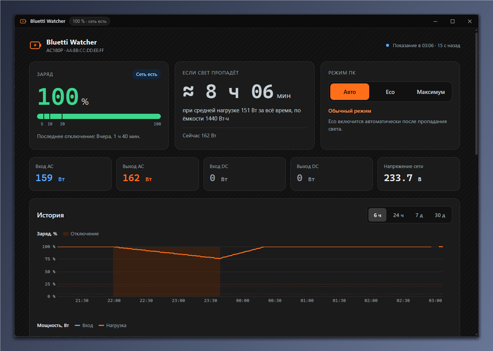
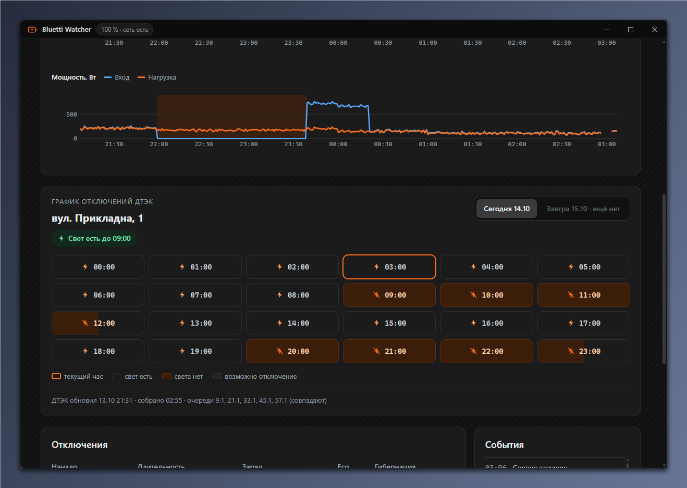
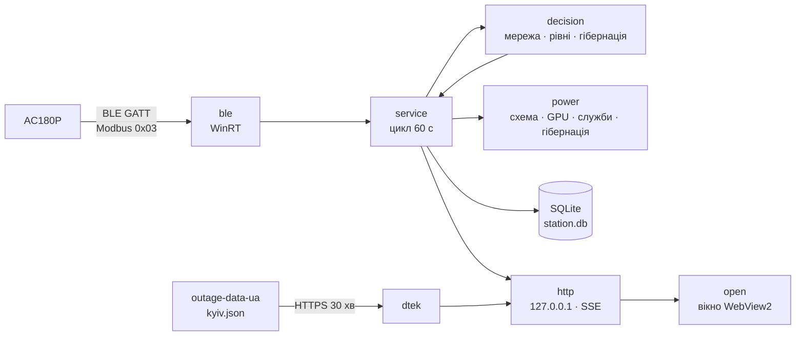

<div align="center">


# Bluetti Watcher

**Стежить за станцією BLUETTI AC180P у фоні й захищає ПК під час відключень світла: спочатку eco-режим, а перед розрядом — гібернація.**

Один exe на Rust: раз на хвилину читає станцію через Bluetooth LE, без вікна й значка в треї; графіки — з ярлика.

[English](README.md) · **Українська** · [Русский](README.ru.md)


</div>

---

<p align="center"></p>

<p align="center"></p>

## Можливості

| | |
|---|---|
| 🔋 **Читання станції через Bluetooth** | Раз на хвилину: заряд, вхід і вихід AC/DC, напруга мережі. Лише читання — налаштувань станції програма ніколи не змінює. |
| 🌙 **Непомітно у фоні** | Без вікна, консолі й значка в треї; запускається при вході у Windows без прав адміністратора. У простої — близько 0 % CPU і кілька мегабайтів пам'яті. |
| 📈 **Дашборд з ярлика** | Власне темне вікно без системної рамки: заряд, скільки залишилося, потужності, графіки за 6 год / 24 год / 7 д / 30 д, відключення й події. |
| ⚡ **Eco під час відключення** | Після 3 хвилин без мережі: схема живлення «Bluetti Eco» (CPU до 80 %, монітор гасне за 3 хв, найкраща енергоефективність), ліміт потужності NVIDIA, зупинка Windhawk і NVIDIA Instant Replay. На 20 % — глибокий eco. |
| 🛌 **Гібернація до розряду** | Сповіщення на 7 %, гібернація на 5 % — лише після свіжого показання, що це підтверджує. При швидкому розряді пороги піднімаються заздалегідь. |
| 🗓 **Графік відключень ДТЕК** | Планові відключення на сьогодні й завтра (Київ), сіткою годин, як у застосунку ДТЕК. Черга визначається за реальними відключеннями, які бачить станція. Лише показ. |

## Як реагує

| Коли | Що відбувається |
|---|---|
| Мережі немає 3 хвилини | Починається відключення, вмикається eco |
| Заряд 20 % | Глибокий eco: CPU до 50 %, GPU на мінімальному ліміті, сповіщення |
| Заряд 10 % | Сповіщення «збережіть роботу» |
| Заряд 7 % | Сповіщення: ПК піде в гібернацію приблизно за N хвилин |
| Заряд 5 % | Гібернація, якщо свіже показання це підтверджує |
| Мережа повернулася на 3 хвилини | Повертаються попередня схема живлення, ліміт GPU і служби |

Рівень спрацьовує лише після двох узгоджених показань. Стрибок заряду (збій або перекалібрування станції) відкидається, а
якщо низький заряд тримається — гібернація чекає 10 хвилин підтвердження. Усі пороги налаштовуються.

**Кнопки режиму ПК** (інтерфейс російською): «Авто» — eco лише під час відключення; «Eco» — eco зараз, навіть при
мережі; «Максимум» — без економії до наступної зміни мережі або «Авто». Сповіщення про низький заряд і гібернація
працюють у будь-якому режимі; гібернацію вимикає лише порожній файл `no-hibernate`.

**Залишок часу** рахується за середнім навантаженням, а не миттєвим: для «якщо світло зникне» — за середнім за всю історію,
під час відключення — за середнім від його початку (або за виміряною швидкістю розряду, коли даних достатньо).

## Встановлення

Свіжа збірка — на сторінці **[Releases](https://github.com/Reva1v/bluetti-watcher/releases)**; можна й зібрати з
вихідного коду (нижче). Далі в PowerShell з теки з exe:

```powershell
.\bluetti-watcher.exe scan | Out-Host                             # знайти станцію: ім'я, адреса, сигнал
.\bluetti-watcher.exe install --elevated-setup | Out-Host         # встановити (станцію знайде сам)
.\bluetti-watcher.exe install --mac AA:BB:CC:DD:EE:FF | Out-Host  # або вказати адресу явно
```

`| Out-Host` потрібен, бо exe зібраний без консолі: так PowerShell дочекається виводу команди.

`install`:
- копіює exe у `%LOCALAPPDATA%\bluetti-watcher\bin\` і пише `config.toml` з адресою станції;
- створює схему живлення «Bluetti Eco» (ваші схеми не змінюються);
- реєструє задачу планувальника `BluettiWatcher`: запуск при вході, без прав адміністратора, перезапуск при збої;
- створює ярлики «Bluetti Watcher» на Робочому столі й у меню «Пуск»;
- запускає сервіс.

`--elevated-setup` один раз запитує UAC: вмикає гібернацію Windows (`powercfg /h on`) і створює задачу
`BluettiWatcherGpu`, яка ставить ліміт GPU та зупиняє/запускає Windhawk і контейнер NVIDIA. Без нього eco працює без
цих частин, а дашборд попередить, якщо гібернацію вимкнено.

Exe не підписаний, тож Windows може попередити при першому запуску. Звірте SHA-256 архіву з файлом `.sha256`.

## Використання

- **Дашборд** — ярлик «Bluetti Watcher». Закриття вікна не зупиняє сервіс; якщо сервіс не запущений, ярлик запустить його.
- **Стан одним рядком** — `bluetti-watcher status | Out-Host`.
- **Перевірка зв'язку** — `bluetti-watcher read-once --trace | Out-Host` друкує поля й кадри протоколу.
- **Вимикач гібернації** — порожній файл `%LOCALAPPDATA%\bluetti-watcher\no-hibernate`; перевіряється щоциклу.
- **Пробний режим** — `dry_run = true` у `config.toml` (або `run --dry-run`): усі дії з ПК лише пишуться в лог.
- **Видалення** — `bluetti-watcher uninstall | Out-Host` повертає схему живлення й прибирає задачі, ярлики та схему
  «Bluetti Eco»; дані залишаються. `--purge` видаляє і їх.

## Налаштування

`%LOCALAPPDATA%\bluetti-watcher\config.toml`. Обов'язковий лише `mac`; решта — значення за замовчуванням:

```toml
mac = "AA:BB:CC:DD:EE:FF"
port = 8765                 # дашборд на 127.0.0.1
poll_sec = 60
dry_run = false

[station]
capacity_wh = 1440          # AC180P
efficiency = 0.85

[mains]
lost_sec = 180              # скільки чекати без мережі до eco
back_sec = 180

[levels]
low = 20                    # глибокий eco
critical = 10
warn = 7
hibernate = 5

[eco]
power_scheme = true
cpu_max_pct = 80
deep_cpu_max_pct = 50
efficiency_overlay = true
monitor_off_sec = 180
gpu = true
gpu_pct = 70                # від номіналу, не нижче мінімального ліміту карти
deep_gpu_pct = 0            # 0 = мінімальний ліміт
stop_replay = true          # зупинити Windhawk, потім контейнер NVIDIA (Instant Replay)

[dtek]
enabled = false
region = "kyiv"             # набір даних kyiv.json
address = ""                # лише підпис на картці
queues = []                 # черги-кандидати, напр. ["GPV9.1", "GPV21.1"]
```

Усі ключі та межі — [contracts/cli-config.md](specs/001-rust-station-watcher/contracts/cli-config.md); графік —
[specs/002-dtek-schedule](specs/002-dtek-schedule/spec.md).

## Безпека й приватність

- До станції йдуть лише команди читання Modbus (0x03) і кроки захищеного з'єднання; тест перевіряє кожен вихідний кадр.
- HTTP слухає лише `127.0.0.1` і відхиляє чужий `Host`; зміна режиму потребує заголовка, який інші сайти надіслати не можуть.
- Єдиний зовнішній запит — HTTPS GET публічного набору даних
  [Baskerville42/outage-data-ua](https://github.com/Baskerville42/outage-data-ua) раз на 30 хвилин і лише при
  `[dtek] enabled = true`. Ваша адреса нікуди не йде; хмари BLUETTI немає.

## Збирання з вихідного коду

Windows 10/11 x64 з Bluetooth LE і [Rust](https://rustup.rs/) stable (1.97+).

```powershell
cargo build --release      # target\release\bluetti-watcher.exe
cargo test                 # протокол, рішення, сховище, API, графік
```

## Архітектура

Однопотоковий сервіс (tokio current_thread): цикл читання раз на хвилину, рішення — чиста функція без I/O, дії з ПК —
через трейти, які в тестах замінюються фейками. Графік оновлюється у власній задачі.



| Шар | Технології |
|---|---|
| Bluetooth і Windows API | `windows` (WinRT GATT і HTTP, powrprof, Task Scheduler, служби, Shell, DWM) |
| Протокол | Modbus RTU, шифрування BLUETTI IoT v2 на RustCrypto (`p256`, `aes`, `cbc`, `md-5`) |
| Сховище | `rusqlite` (SQLite, bundled) |
| API і дашборд | `axum`, SSE, HTML/CSS/JS без фреймворків, графіки uPlot |
| Вікно | `wry` + `tao` (WebView2) |
| GPU і сповіщення | `nvml-wrapper`, `tauri-winrt-notification` |

## Структура проєкту

```
src/ble/           читання станції: WinRT-транспорт, Modbus, шифрування, регістри AC180P, сканування
src/decision/      рішення: перевірки показань, мережа й відключення, рівні та гібернація
src/power/         eco: схема «Bluetti Eco», оверлей, ліміт GPU, служби, гібернація
src/dtek/          графік ДТЕК: завантаження набору, розбір, вікна відключень, вибір черги
src/http/          API, SSE і вбудований дашборд (web/)
src/service.rs     цикл сервісу
src/install.rs     install / uninstall / status
src/window.rs      вікно дашборда
tests/             протокол проти фейкової станції, сценарії рішень, фікстура набору
specs/             специфікації, плани, задачі (Spec Kit; російською)
design/            макети дашборда
docs/images/       скриншоти для README
```

## Розробка

```powershell
cargo fmt --check
cargo clippy --all-targets -- -D warnings
cargo test                                   # 167 тестів
cargo test --lib -- --ignored real_fetch     # один реальний запит до набору даних ДТЕК
```

Фічі ведуться за Spec Kit: у [`specs/`](specs/) — специфікації, плани, дослідження протоколу, контракти API та сценарії
перевірки (російською).

## Походження й ліцензія

Переписано на Rust з [vitaliy-shatskiy/bluetti-watcher](https://github.com/vitaliy-shatskiy/bluetti-watcher)
(C# + Python): правила рішень перенесено звідти, хмарне джерело й флаг-файл прибрано, модуль ДТЕК зроблено заново на
публічному наборі даних. Протокол станції портовано з [bluetti-bt-lib](https://pypi.org/project/bluetti-bt-lib/).
Ліцензія — [MIT](LICENSE).

Незалежний проєкт, не пов'язаний з BLUETTI чи ДТЕК.
